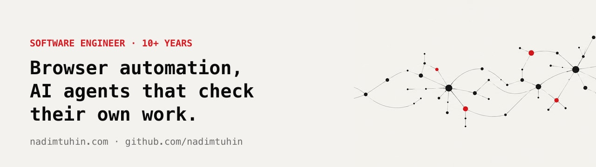
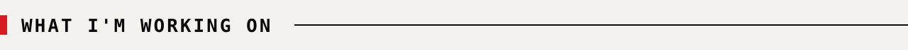
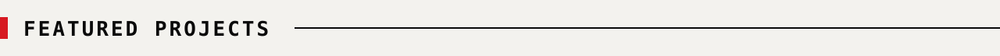
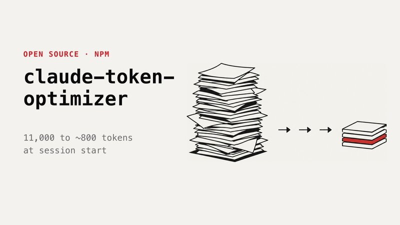
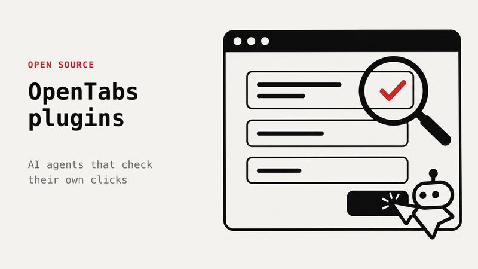
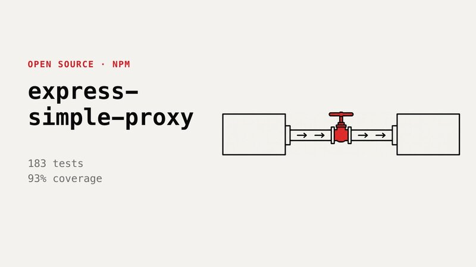
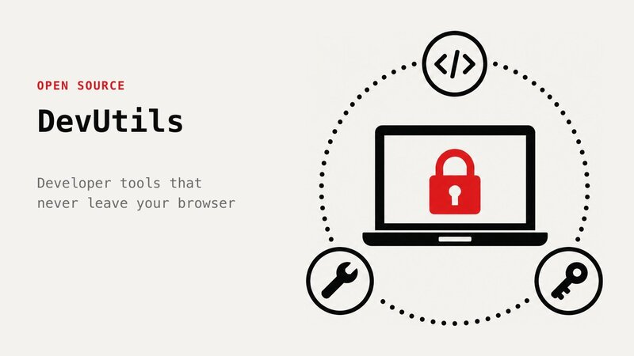
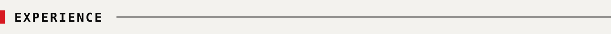
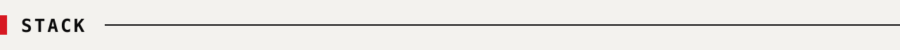
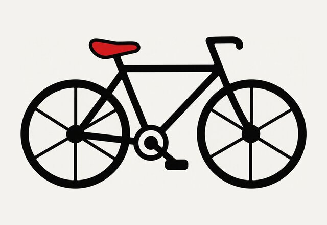

<h1>Nadim Tuhin Omar Faruque Tuhin</h1>

**Software engineer, 10+ years.** I build browser automation, AI agent tooling, and the backend systems underneath them.

Seven years at [Pathao](https://pathao.com) (2M+ daily users, 100K+ daily orders), where I led platform work, mentored 8 engineers, and pushed the move off Facebook Workplace Chat to self-hosted Mattermost, which cut about **$10K a month**. Most recently Tech Lead at [Technovative Solutions](https://www.technovativesolutions.co.uk/) (UK). I write at [nadimtuhin.com](https://nadimtuhin.com).

> [!NOTE]
> **Open to** Senior, Staff, Lead and Full Stack roles. Remote or hybrid. [Book a 30 min call](https://calendly.com/nadimtuhin/30min)

 

<table>
<tr>
<td width="62%" valign="middle">

Making AI agents reliable on real websites.

**Pages lie.** A click returns fine and nothing changes. A field shows the new text and saves the old one.

Most of my recent work is about agents that **read the result back** before they call anything done.

</td>
<td width="38%" valign="middle"></td>
</tr>
</table>

 

<table>
<tr>
<td width="50%" valign="top">

**[claude-token-optimizer](https://github.com/nadimtuhin/claude-token-optimizer)** &nbsp;`★ 618` `npm`

Claude Code burned 11,000 tokens before I typed a word. I split the docs so only 4 small files load at startup. Now it's about 800.
</td>
<td width="50%" valign="top">

**[opentabs-plugins](https://github.com/nadimtuhin/opentabs-plugins)** &nbsp;`TypeScript` `CDP`

The agent said done. The page hadn't changed. These plugins read the result back after every click and never submit on their own.
</td>
</tr>
<tr>
<td width="50%" valign="top">

**[express-simple-proxy](https://github.com/nadimtuhin/express-simple-proxy)** &nbsp;`183 tests` `npm`

Every request goes through the proxy, so when it breaks, everything breaks. 93% coverage and a Trivy scan in CI.
</td>
<td width="50%" valign="top">

**[devutils](https://github.com/nadimtuhin/devutils)** &nbsp;`★ 14` `React`

Most online JWT decoders send what you paste to a server. These 35+ dev tools run fully in your browser, offline.
</td>
</tr>
</table>

Also: <a href="https://github.com/nadimtuhin/ytranscript">ytranscript</a>, a YouTube transcript CLI with bulk mode and an MCP server.

  

| Role | Company | When |
|:--|:--|:--|
| **Tech Lead** | [Technovative Solutions](https://www.technovativesolutions.co.uk/) · [DigiProdPass](https://digiprodpass.com/) | <code>2025&nbsp;→&nbsp;2026</code> |
| **Tech Lead & Staff Software Engineer** | [Pathao](https://pathao.com) | <code>2018&nbsp;→&nbsp;2025</code> |
| **Software&nbsp;Engineer&nbsp;→ Backend&nbsp;Tech&nbsp;Lead** | Cookups · Gagagugu · ThemeXpert · The Software Engineers | <code>2013&nbsp;→&nbsp;2018</code> |

 

**Backend** &nbsp; `Node.js` `Bun` `TypeScript` `Python` `Go` `REST` `GraphQL` 
**Data** &nbsp; `PostgreSQL` `Redis` `MongoDB` 
**Agents & automation** &nbsp; `Playwright` `Puppeteer` `Chrome DevTools Protocol` `MCP` `Claude` 
**Frontend** &nbsp; `React` `Next.js` `Vue.js` 
**Infra** &nbsp; `Docker` `Kubernetes` `Cloudflare Workers` `GitHub Actions`

 

<table>
<tr>
<td width="30%" valign="middle"></td>
<td width="70%" valign="middle">

**Off the keyboard, I'm on a bicycle.**

[nadimtuhin.com](https://nadimtuhin.com) · [Resume](https://nadimtuhin.com/resume.pdf) · [Book a call](https://calendly.com/nadimtuhin/30min) · [LinkedIn](https://www.linkedin.com/in/nadimtuhin) · [X](https://x.com/nadimtuhin) · [Email](mailto:nadimtuhin@gmail.com)

</td>
</tr>
</table>
